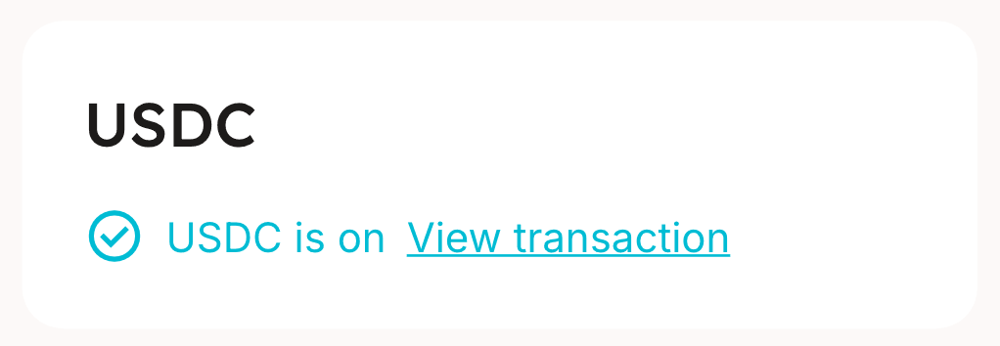
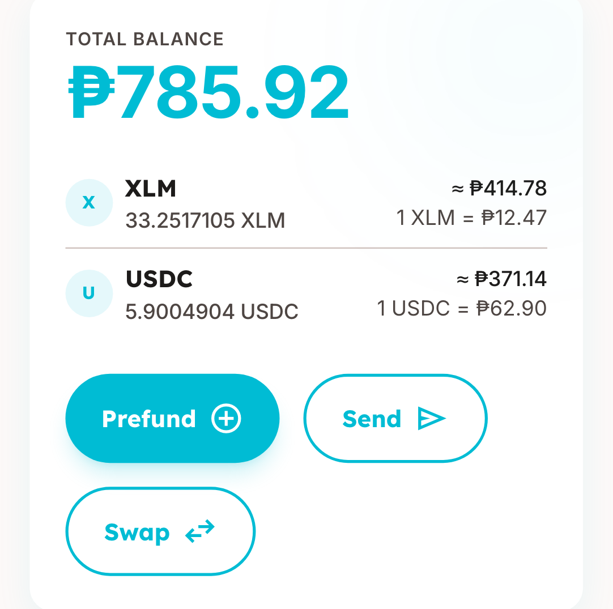
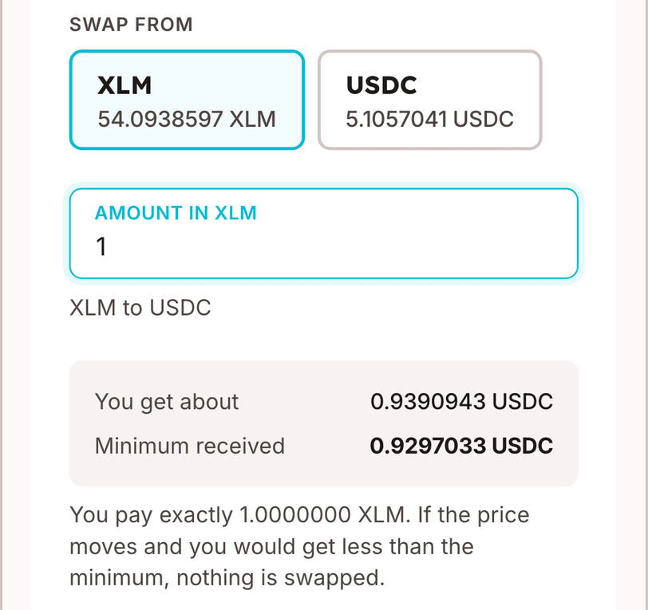
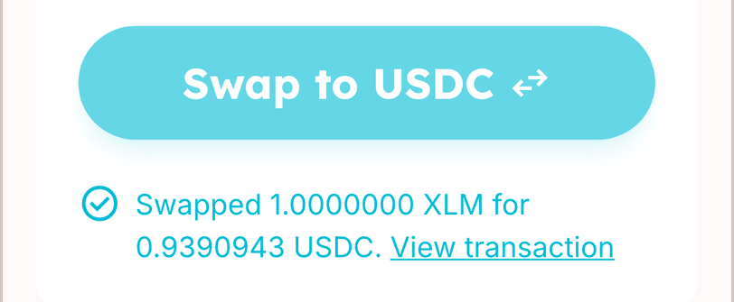
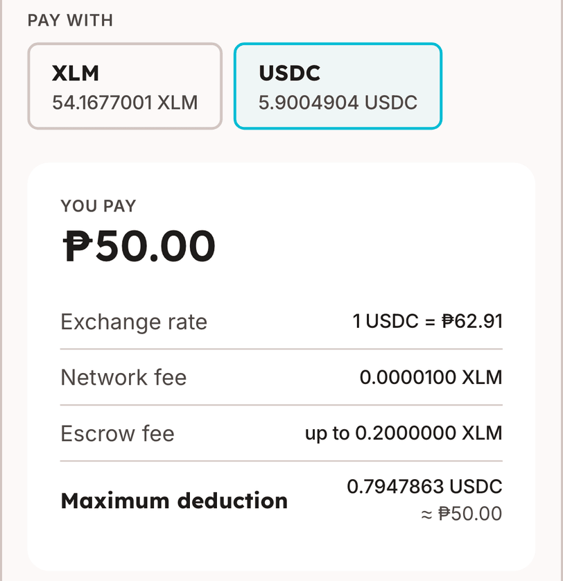

# HeyPay recorded test — Week 3

**What we are testing this week:** paying a shop with **USDC**, a digital dollar. You try it too early, turn it on, and swap XLM and USDC both ways. Then you pay with it, and watch a failed payment come back as USDC.

| Time needed                                          | Tasks                       | Thank-you                |
| ---------------------------------------------------- | --------------------------- | ------------------------ |
| About 70 minutes: 8 to set up, 62 recorded with Loom | 6 tasks + closing questions | ₱{{INCENTIVE_INTERVIEW}} |

**[Open HeyPay](https://heypayfi.xyz)** · **[Send your files]({{HANDIN_URL}})** · **[Report a bug]({{BUG_FORM_URL}})**

## Before you begin

**You need:**

- A laptop or desktop computer with Chrome, Edge or Safari.
- The HeyPay website: **[heypayfi.xyz](https://heypayfi.xyz)**.
- The Loom desktop app (set up below).
- A Google account, to upload your files at the end.
- The picture we sent you: `closed-account-shop.png`. It is the QR code of a practice shop whose bank account is closed. You use it in T5.
- Your HeyPay **payer** account from last week, if you tested then. If not, you make one in T1.
- A quiet place for about an hour and a quarter.

You do not need the Freighter wallet this week.

**You will send us three things.** Together they make you eligible for your ₱{{INCENTIVE_INTERVIEW}}:

1. A **Loom recording** of your session, with your screen, face and voice.
2. Your **screenshots**, named as the tasks tell you, in one zip file.
3. Your **answers file**, with the interview questions answered as you go.

> **Testnet only — this is play money.** Everything in this test uses practice money that has no value. HeyPay will never ask you for real money, a bank card, or a secret phrase. If anything asks for one, stop and tell us.

> **We are testing HeyPay, not you.** Please think out loud the whole time. Say what you expect, what surprises you, and what you would do next. Confusion is useful to us.

**What we record:**

- Your screen, your voice and your camera, through Loom, for as long as you record. The recording is not blurred, so it shows everything on your screen.
- Your answers file and screenshots.
- The HeyPay account you use, and which pages were opened in it.
- The email address you sign up with, if you make a new account.

Close anything private (email, chats, banking) before you start recording. Your password shows as dots on screen, so the recording does not show it.

## Set up Loom (6 minutes)

Recording yourself is required: face, voice and screen together. If being on camera is a problem, or you have no Mac or Windows computer, message us before you start.

1. Sign up at **[loom.com](https://www.loom.com)**. Install the **Loom desktop app** from **[loom.com/download](https://www.loom.com/download)** and sign in. Do not use the Chrome extension: its camera bubble disappears when you switch tabs.
2. Start the free **Business trial**. The free plan stops every recording after 5 minutes. No card is needed.
3. Set the recorder to **Screen + Camera**, with your microphone on, and **Full screen**, not one window or tab.
4. On a Mac, allow Loom under **System Settings** → **Privacy & Security** → **Screen Recording**, **Camera** and **Microphone**.
5. Record a **10-second test clip**. Say your name, switch to another tab, then stop. Play it back.
   - [ ] You can hear yourself, see your screen, and your face stays in the corner after you switch tabs.
6. Delete the test clip. Do not start the real recording yet: create your answers file first.

Did you set up Loom last week? Then only do step 5.

## Create your answers file (2 minutes)

1. Copy the **Answers file template** at the end of this guide into a text file or a document.
2. Save it as `answers-<your name>`.
3. Fill in **About you** now. Keep the file open in another window while you test.

After each task, say your answer to the interview question out loud, then write a line or two in your answers file. Every question is written out in the answers file too. You do not have to come back to this guide to find it. Your first reaction is what we want, even "I have no idea".

## Screenshots

We ask for **12 screenshots with a name**, plus one or more of your own in T6. Each one shows what HeyPay told you or did with your money, so together with your recording they are our proof. Please take every one.

The two that matter most are `t1a-message.png` and `t5c-balance-after.png`. Without them we cannot count the session as complete.

- Each screenshot has an orange **SCREENSHOT** tag and a tick box, at the step where you take it. Take it right then. Some screens are gone a minute later.
- Capture your **whole screen**, not a part of it. On Windows, press **Win + PrtScn**: the picture is saved in **Pictures** → **Screenshots**. On a Mac, press **Cmd + Shift + 3**: the picture is saved on your **Desktop**.
- Do not stop to rename each one. After each task, rename that task's screenshots to the names in the tags. They are in the order you took them.
- Put them all in one folder, and zip it at the end. The **Screenshot checklist** near the end of this guide lists every one.
- Missed one? Go on, and write which one in your answers file. Do not make a payment again just for a screenshot.

## Words you'll see

| Word                 | What it means                                                                                                               |
| -------------------- | --------------------------------------------------------------------------------------------------------------------------- |
| **Payer**            | A customer who pays a shop with HeyPay. In this test, that is you.                                                          |
| **Merchant**         | A shop that gets paid through HeyPay. It is paid in pesos (PHP).                                                            |
| **Testnet**          | The practice version of Stellar and of HeyPay. It uses play money.                                                          |
| **XLM**              | One kind of play money in your HeyPay account. 1 XLM is worth about ₱12.                                                    |
| **USDC**             | The other kind of play money: a digital dollar. 1 USDC is worth about ₱63.                                                  |
| **Wallet**           | The place inside your HeyPay account where your play money is kept.                                                         |
| **Turn on USDC**     | Allow your account to hold digital dollars. It is done once.                                                                |
| **Trustline**        | The technical word for that permission: permission to hold a coin.                                                          |
| **Swap**             | Change one kind of money into the other inside your own account, like at a money changer.                                   |
| **Minimum received** | The least you get from a swap. If the swap cannot give you that much, nothing is swapped.                                   |
| **QRPH**             | The same QR codes shops already put on their counters for bank and GCash payments.                                          |
| **Stellar**          | The public payment network HeyPay uses to move money.                                                                       |
| **Exchange rate**    | How many pesos one XLM or one USDC is worth right now. HeyPay holds it still for 90 seconds while you decide.               |
| **Quote**            | A price HeyPay offers you for a short time, before you agree to it.                                                         |
| **Network fee**      | A tiny charge, less than one centavo, for sending a payment on Stellar. It is always in XLM.                                |
| **Escrow**           | A locked box on Stellar. It holds your payment until the shop is paid. If the shop cannot be paid, it gives the money back. |
| **Escrow fee**       | A small charge for putting your payment into the escrow. It is always in XLM. The app shows the most it can be.             |
| **Refund**           | Your money coming back to you after a payment that did not go through.                                                      |
| **Stellar Expert**   | A public website where anyone can look up a payment, like a tracking page for a parcel.                                     |

## What changed since last week

**New this week**

- You try to pay in USDC before you have any, and read HeyPay's message out loud. T1 tests this.
- **Turn on USDC**: allowing your account to hold digital dollars. T2 tests this.
- The **Swap** page: you swap XLM to USDC, and USDC back to XLM. T3 tests this.
- You pay the test shop in USDC. Last week you paid in XLM. T4 tests this.
- You pay a shop that cannot be paid, in USDC, and check that USDC comes back. T5 tests this.
- Your play money comes from last week's account, or from the **Claim 20 XLM** button.
- We ask for fewer screenshots: 12 with a name, instead of 16.
- The **Dashboard** now lists **XLM** and **USDC**, and has a **Swap** button. The **Transactions** page has a **Swaps** list.
- Making a new account now asks for an email address and a 6-digit code, or a Google account.

**No longer tested**

- Setting up Freighter and sending play money from it into HeyPay (last week's T1).
- Looking up your HeyPay wallet's history on Stellar Expert (last week's T1).
- Paying the test shop in XLM (last week's T2). This week's payment is in USDC.
- Reading the **Held in escrow** box, and the question about who was holding your money (last week's T2).
- Following your payment through the escrow (last week's T3): the deposit page, the escrow contract's page and its history list. One quick look at Stellar Expert stays, in T4.
- The question "In your own words, what is the escrow?"
- A failed payment refunded in XLM (last week's T4). This week's refund is in USDC.
- Opening the refund on Stellar Expert and on the escrow contract's page (last week's T4).

## At a glance

You are the customer for the whole test. You pay one shop that works, and one shop that cannot be paid.

| Task                                       | Minutes | Screenshots | Done |
| ------------------------------------------ | ------- | ----------- | ---- |
| T1 Try to pay in USDC too early            | 8       | 1           | ☐    |
| T2 Turn on USDC                            | 5       | 1           | ☐    |
| T3 Swap XLM to USDC, and back              | 12      | 3           | ☐    |
| T4 Pay the test shop in USDC               | 12      | 3           | ☐    |
| T5 Pay a shop that cannot be paid, in USDC | 12      | 4           | ☐    |
| T6 Explore on your own                     | 5       | 1 or more   | ☐    |
| Closing questions                          | 8       | —           | ☐    |

<div class="card">

## T1 — Try to pay in USDC too early (8 minutes)

**Why this matters:** a new customer may pick USDC before their account is ready for it. HeyPay's message then has to say what to do next.

**Start your Loom recording now.**

1. Open **[heypayfi.xyz](https://heypayfi.xyz)** and click **Open HeyPay**.
   - [ ] You see a sign-in page with a **Sign in** button.
2. Type the **Email or username** and **Password** of last week's **payer** account. Click **Sign in**.
   - [ ] You see a page called **Dashboard**.
3. Write your payer username in your answers file. Do not write the password there.
4. Look under **Total Balance**. Read the **XLM** line and the **USDC** line out loud.
   - [ ] The **XLM** line shows **12 XLM** or more. That is about ₱150 of play money.
5. On the **Scan QRPH** card, click **Start Payment**.
   - [ ] You see **Scan to Pay**, with **Use camera** and **Upload image** buttons, and a card called **Test shop QR**.
6. In the **Test shop QR** card, click **Download QR**.
   - [ ] A picture called `heypay-test-shop.png` is saved to your computer.
7. Click **Upload image** and choose `heypay-test-shop.png`.
8. Under **Amount to pay (PHP)**, type **50**. If you see a small **PHP** and **XLM** switch, leave it on **PHP**. Click **Continue**.
   - [ ] You see **Confirm Payment** with the name **HeyPay Test Shop**.
9. Find **Pay with**. Say out loud what you think the two boxes under it are for. Then click **USDC**.
   - [ ] A red message shows near the bottom, above the **Confirm** button.
   - [ ] It says **Turn on USDC first.** or **Not enough USDC — add more or pay with XLM.**
   - [ ] **SCREENSHOT:** t1a-message.png, the **Confirm Payment** screen with the red message.
10. Read the red message out loud, and anything new under it. Say what you think HeyPay wants you to do. Do not click it.
11. Click **Cancel**.
    - [ ] You are back on the **Dashboard**. Your **Total Balance** is the same as in step 4.

**New this week, or forgot your password?** Make a new account in place of step 2:

- Click **Create an account** under the **Sign in** button. Under **I am a**, click **Payer**.
- Type your **Email**. Make up a **Username** and a **Password** of at least 8 characters. Click **Create account**.
- HeyPay emails you a 6-digit code. Read that email on your phone, so your inbox is not in the recording.
- Type the code on the **Check your email** page. Click **Confirm and create account**.
- On the **Dashboard**, find the card **Get 20 XLM to try HeyPay**. Click **Claim 20 XLM**. That is about ₱250 of play money.

**If it doesn't match:** less than 12 XLM in step 4? Click **Claim 20 XLM** if you see it. For anything else, check _Troubleshooting_, then [report it]({{BUG_FORM_URL}}).

> **Interview question:** What did the message tell you? What would you have done next if this were real money? What should it say instead?

</div>

<div class="card">

## T2 — Turn on USDC (5 minutes)

**Why this matters:** on Stellar, an account must be allowed to hold a coin before it can receive any. HeyPay calls that turning on USDC. We want to know if the idea makes sense to you.

1. Click **Settings** in the menu.
   - [ ] You see **Settings**, and a card called **USDC**.
2. Read the **USDC** card out loud. Say what you think it is for.
3. Does the card have a **Turn on USDC** button? Say what you expect to happen, then click it.
4. Does the card already say **USDC is on**? Then HeyPay turned it on for you when your play money arrived. Say whether you had noticed.
   - [ ] The card shows a tick and the words **USDC is on**.
   - [ ] **SCREENSHOT:** t2a-usdc-on.png, the **Settings** page with the **USDC** card.

   

5. If you see **View transaction** next to **USDC is on**, click it. If it is not there, go on.
   - [ ] A new tab opens on the Stellar Expert website, on a page called **Transaction**.
   - [ ] **Status** says **Successful**.
6. Say out loud what you think that page shows. Then close the tab.

**If it doesn't match:** if you see **Fund your wallet with at least 1.0 XLM first.**, you have no play money yet. Click **Claim 20 XLM** on the **Dashboard**, then come back. For anything else, [report it]({{BUG_FORM_URL}}).

> **Interview question:** In your own words, what does turning on USDC do? Should HeyPay ask you first, or do it for you without asking?

</div>

<div class="card">

## T3 — Swap XLM to USDC, and back (12 minutes)

**Why this matters:** you need some USDC before you can pay with it. A swap changes money inside your own account, and it must show the price before you agree.

1. Click **Dashboard** in the menu. Under **Total Balance**, click **Swap**.

   

   - [ ] You see a page called **Swap**, with **XLM** and **USDC** under **Swap from**.
   - [ ] You see a card called **Recent swaps**.

2. Find the note that starts with **Testnet prices do not reflect market prices**. Read it out loud. Say what you think it means.
3. Check that **XLM** is chosen under **Swap from**. Click the box **Amount in XLM** and type **10**. That is about ₱125 of play money.
   - [ ] A grey box shows **You get about** and **Minimum received**.
   - [ ] Under the box you see **You pay exactly 10.0000000 XLM.**
   - [ ] **SCREENSHOT:** t3a-quote.png, the **Swap** page with the grey box. Take it first, before you read.

   

   An example with 1 XLM. Your page shows 10 XLM and other numbers.

4. Read the grey box and the sentence under it out loud. Say how many USDC you expect to get. Say what happens if the price moves.
5. Click **Swap to USDC**.
   - [ ] You see **Swapped 10.0000000 XLM for** and an amount in **USDC**.
   - [ ] **SCREENSHOT:** t3b-swapped.png, the **Swap** page with the **Swapped** message.

   

   An example. Yours says 10.0000000 XLM.

6. Compare the USDC you got with **Minimum received** out loud. Write the USDC amount in your answers file.
7. Now swap back. Under **Swap from**, click **USDC**. Click the box **Amount in USDC** and type **2**. That is about ₱126.
   - [ ] The grey box now shows **You pay at most** and **Minimum received**.
   - [ ] Under the box you see **You receive exactly the minimum.**
8. Read the grey box and the sentence under it out loud. Say what is different from the first swap.
9. Click **Swap to XLM**.
   - [ ] You see **Swapped**, an amount in **USDC**, the word **for**, and an amount in **XLM**.
10. Scroll down to **Recent swaps**.
    - [ ] The list has two lines. The lower one starts with **10.0000000 XLM →**.
    - [ ] Each line has a **View transaction** link.
    - [ ] **SCREENSHOT:** t3c-recent-swaps.png, the **Recent swaps** list with both lines.
11. Click **Dashboard** in the menu. Read **Total Balance** and the **XLM** and **USDC** lines out loud. Say whether the numbers look right to you after two swaps.

**If it doesn't match:** if you see **There are no offers to swap this amount right now. Try a smaller amount.**, type a smaller amount. If the swap back still fails, say so out loud and go on to T4. For anything else, check _Troubleshooting_, then [report it]({{BUG_FORM_URL}}).

> **Interview question:** Before you clicked, did you know how much you would get? What did **Minimum received** mean to you? Would you swap real money this way?

</div>

<div class="card">

## T4 — Pay the test shop in USDC (12 minutes)

**Why this matters:** this is the main thing HeyPay does. This week you pay in digital dollars, and the shop still gets pesos.

1. On the **Dashboard**, click **Start Payment**. Click **Upload image** and choose `heypay-test-shop.png` again.
2. Under **Amount to pay (PHP)**, type **50** and click **Continue**.
   - [ ] You see **Confirm Payment** with the name **HeyPay Test Shop**.
3. Under **Pay with**, click **USDC**.
   - [ ] The page loads again. **Exchange rate** now starts with **1 USDC = ₱**.
   - [ ] You see **Rate locked for** with a countdown in seconds.
   - [ ] **SCREENSHOT:** t4a-confirm-usdc.png, the **Confirm Payment** screen in USDC. Take it first, before you read.

   

4. Read the screen out loud: **You pay**, **Exchange rate**, **Network fee**, **Escrow fee** and **Maximum deduction**. Say which amounts are in USDC and which are in XLM.
5. Before the countdown ends, click **Confirm**.
   - [ ] You see **Processing payment…** with a list of five steps.
6. Wait, and keep thinking out loud. The step **Paying the merchant in PHP** can take up to **5 minutes**. That is normal in this test.
   - [ ] You see **₱50.00 sent to HeyPay Test Shop**.
   - [ ] **SCREENSHOT:** t4b-sent.png, the **₱50.00 sent to HeyPay Test Shop** screen.
7. Click **Done**.
   - [ ] You see the **Transactions** page. The top line of **Payments** shows **SETTLED** and an amount in **USDC**.
8. Read the **Payments** list out loud, line by line. Say what you think each label means, and whether any line worries you.
9. Click the top payment.
   - [ ] You see **Payment detail**, with a row called **USDC debited**.
   - [ ] You see two rows with a code: **Escrow deposit on Stellar** and **Escrow release on Stellar**.
10. One quick check on a public website. Click the small arrow icon next to the code under **Escrow release on Stellar**.
    - [ ] A new tab opens on the Stellar Expert website, on a page called **Transaction**.
    - [ ] **Status** says **Successful**.
    - [ ] **SCREENSHOT:** t4c-stellar-expert.png, the whole **Transaction** page.
11. Say out loud whether that page tells you the payment went through. Then close the tab.

**If it doesn't match:** if you see **Quote expired — rescan to get a fresh rate.**, start again from step 1. For anything else, write down the exact message and [report it]({{BUG_FORM_URL}}).

> **Interview question:** You paid in digital dollars and the shop got pesos. Was it clear how much you paid, in which money, and what the fees were?

</div>

<div class="card">

## T5 — Pay a shop that cannot be paid, in USDC (12 minutes)

**Why this matters:** payments fail sometimes. If you paid in USDC, you should get USDC back, and you should be able to see that it came back.

The shop in this task has a closed bank account, so the bank refuses the transfer. We set it up this way on purpose.

1. Click **Dashboard** in the menu. Read the **USDC** line under **Total Balance** out loud. Write the USDC amount in your answers file under T5.
   - [ ] **SCREENSHOT:** t5a-balance-before.png, the **Dashboard** before this payment.
2. Click **Start Payment**. Click **Upload image** and choose `closed-account-shop.png`, the picture we sent you.
3. Under **Amount to pay (PHP)**, type **30** and click **Continue**.
   - [ ] You see **Confirm Payment** with the name **Closed Account Shop**.
4. Under **Pay with**, click **USDC**. When the page has loaded again, click **Confirm**.
   - [ ] You see **Processing payment…** with the list of steps.
5. Stay on this screen and keep thinking out loud. It can take up to **5 minutes**. Say what you expect to happen.
   - [ ] You see **Payment failed** or **Payment refunded**, in red.
   - [ ] **SCREENSHOT:** t5b-result.png, the red screen as soon as it shows. If it changes, take one more and call it `t5b-result-2.png`.
6. Read the message under it out loud. It has technical words: say what you think it means anyway.
7. Wait until the screen says **Payment refunded**. Then click **Back**.
   - [ ] You see the **Dashboard**. The **USDC** line shows the same amount you wrote down in step 1.
   - [ ] The **XLM** line is a little lower than before. The fees are not returned.
   - [ ] **SCREENSHOT:** t5c-balance-after.png, the **Dashboard** after the refund.
8. Click **History** in the menu.
   - [ ] Your ₱30 payment is at the top of **Payments**, with the label **REFUNDED** and an amount in **USDC**.
9. Click the payment.
   - [ ] You see **Payment detail**, with the rows **USDC debited** and **Escrow refund on Stellar**.
   - [ ] **SCREENSHOT:** t5d-detail.png, **Payment detail** showing **Escrow refund on Stellar**.
10. Read **Payment detail** out loud. Say whether it tells you that your USDC came back.

**If it doesn't match:** if you see **₱30.00 sent to Closed Account Shop**, stop and [report it]({{BUG_FORM_URL}}): that shop should never be paid. If nothing changes after 10 minutes, write down what the screen says and report it.

> **Interview question:** Your money came back as USDC. Is that what you expected? What told you it was back, and how sure were you?

</div>

<div class="card">

## T6 — Explore on your own (5 minutes)

**Why this matters:** you will find things our tasks did not think of.

Click around freely. Keep thinking out loud. Try things you would try as a real customer.

- [ ] **SCREENSHOT:** t6-1.png, anything in HeyPay that confused or surprised you. Take more if you like: `t6-2.png`, `t6-3.png` and so on. Say out loud why you took each one.

> **Interview question:** What was the most confusing thing you saw today?

</div>

## Closing questions (8 minutes)

Keep recording. These are the same nine questions we ask every week. They are also in the **CLOSING QUESTIONS** block of your answers file, with the same numbers. Read each one here, say your answer out loud, then write it under the same number in your answers file. Take your time. These are the answers we read most carefully.

1. In your own words, what does HeyPay do? Explain it like you would to a friend.
2. Would you trust HeyPay with real pesos today? If not, what would have to change first?
3. From 0 to 10, how likely are you to recommend HeyPay to a shop owner you know? Why that number, and not one higher?
4. What did you like most?
5. What should we fix first?
6. What one feature would make HeyPay much more useful to you?
7. How comfortable were you with crypto before today? Did this session change that?
8. Was there anything you expected to find and didn't?
9. May we follow up with you? If yes, write your email.

Then fill in **QUICK RATINGS** near the top of the file. It is easy to miss, and it is the only place we ask for them.

Stop the Loom recording now.

## Known issues

- Some small labels are in capital letters on screen, for example **PAY WITH**, **SWAP FROM** and **TOTAL BALANCE**. This guide writes them as **Pay with**, **Swap from** and **Total Balance**.
- After a swap, your **Total Balance** in pesos can jump up or down a lot. Testnet prices are not real prices. The **Swap** page says so in a note.
- The **Swap** page asks for a new price every 15 seconds, so the numbers can change a little while you read.
- When you swap USDC to XLM, HeyPay can use a little less USDC than you typed. The rest stays in your account.
- The **Swap** page is not in the menu. Open it from the **Dashboard**.
- On **Confirm Payment**, **Network fee** and **Escrow fee** are in XLM even when you pay in USDC. **Maximum deduction** shows only the USDC.
- After you choose **USDC** on **Confirm Payment**, the **Transactions** page shows one more line for the same shop. It is marked **FAILED** and is in XLM. That is the first price, which the USDC price replaced. No money moved.
- The payment you cancelled in T1 also shows as **FAILED**. No money moved.
- The step **Paying the merchant in PHP** can take up to **5 minutes**. This test uses the practice (test) mode of our payout partner, which is slower than the real service.
- The message under **Payment failed** shows a technical code, for example `Payout disb-… failed: INVALID_DESTINATION`. That is normal for now. Tell us what you would want it to say.
- A refunded payment still has a row called **USDC debited** in **Payment detail**. The USDC did come back.
- The progress screen calls the escrow step **Sending crypto to HeyPay**. Your money goes into the escrow at that step.
- The page title says **Transactions**, but the menu item says **History**. They are the same page.
- The codes under **Escrow deposit on Stellar** and the other rows are shortened, for example `a1b2c3d4…e5f6a7b8`. That is normal.
- **Payment detail** shows codes like `STELLAR_SUBMITTED` in the **Timeline**. That is normal for now.
- The Stellar Expert pages are dark and use technical words. You only need to find **Status**.
- The **Support** link in the menu does not open a page yet.

## Troubleshooting

| You see                                                                    | Try                                                                                                                                         |
| -------------------------------------------------------------------------- | ------------------------------------------------------------------------------------------------------------------------------------------- |
| "Invalid email, username or password."                                     | Check for a typo and try once more. Still not working? Make a new account, as T1 shows.                                                     |
| "That username is taken. Choose another one."                              | Someone already has that username. Add a number or your initials.                                                                           |
| No email with the 6-digit code                                             | Look in your spam folder. Then click **Send a new code**.                                                                                   |
| "That code is not right. Check the email and try again."                   | Use the code from the newest email. The code works for 10 minutes.                                                                          |
| No **Get 20 XLM to try HeyPay** card, and less than 12 XLM                 | Report it with your username. We will send play money to your account.                                                                      |
| "Could not start payment. Try again."                                      | You may have too little XLM: every payment starts in XLM. Check the **XLM** line on the **Dashboard**. Claim 20 XLM, or swap 1 USDC to XLM. |
| "Not enough XLM — add more or pay with USDC."                              | Click **Pay with USDC**.                                                                                                                    |
| The words **Trustline needed** under **USDC**                              | USDC is not on yet. That is fine in T1. After T1, do T2.                                                                                    |
| A card called **Turn on USDC to swap**                                     | USDC is not on yet. Click **Turn on USDC** on that card, then go on with T3.                                                                |
| "Fund your wallet with at least 1.0 XLM first."                            | Your account has no play money yet. Click **Claim 20 XLM** on the **Dashboard**, then try again.                                            |
| "Getting a price…" and nothing else                                        | Wait 10 seconds. Still nothing? Reload the page and type the amount again.                                                                  |
| "There are no offers to swap this amount right now. Try a smaller amount." | Type half the amount. If that fails too, type **1**. Say out loud which amount worked.                                                      |
| "The price changed. Check the new amount and swap again."                  | Read the new numbers out loud, then click the swap button again.                                                                            |
| "Not enough XLM. You can swap up to …"                                     | Swap the amount the message names, or less. A little XLM always stays in your account.                                                      |
| "Not enough USDC. You can swap up to …"                                    | Type the amount the message names, or less.                                                                                                 |
| "Not enough USDC — add more or pay with XLM." in T4 or T5                  | You have too little USDC left. Swap 5 XLM to USDC on the **Swap** page, then start the payment again.                                       |
| "Not enough XLM for the network fee — add about 0.21 XLM."                 | Fees are paid in XLM. On the **Swap** page, swap **1** USDC to XLM, then start the payment again.                                           |
| "Could not read this code. Try again."                                     | Use the picture file itself, not a photo of your screen.                                                                                    |
| "Merchant not registered"                                                  | That picture is not one of the two test shops. Click **Scan again** and choose the right file.                                              |
| "Quote expired — rescan to get a fresh rate."                              | You waited more than 90 seconds. Start the payment again.                                                                                   |
| Loom stopped after 5 minutes                                               | The Business trial did not start. Start it, record the rest in a new video, and send us every link.                                         |
| Your face disappears when you switch tabs                                  | You are on the Loom Chrome extension. Use the desktop app for the rest, and send us every link.                                             |
| Loom shows a black screen or no camera (Mac)                               | Allow Loom under **System Settings** → **Privacy & Security**, then quit and reopen Loom.                                                   |

## Not in this round

- Freighter, and sending play money into HeyPay from another wallet. We tested that last week.
- **Your own wallet** and **Connect Freighter** in **Settings**. If you see them, leave them.
- Following a payment through the escrow contract on Stellar Expert. One quick look in T4 is enough.
- A failed payment refunded in XLM. This week's refund is in USDC.
- The **Refund from escrow** button. It lets you take your money back yourself when a payment has been stuck for about a day. We cannot make a payment get stuck on demand, so you will not see it.
- Sending USDC into HeyPay from another wallet (the **Prefund** page).
- Paying with your camera. Use **Upload image**.
- Opening a shop and the shop's pages, and the admin pages.
- Anything with real money.

## Screenshot checklist

Tick each one off before you zip the folder. All of them show your whole screen.

| File                     | What it shows                                             | Have it |
| ------------------------ | --------------------------------------------------------- | ------- |
| `t1a-message.png`        | **Must.** Confirm Payment with the red message about USDC | ☐       |
| `t2a-usdc-on.png`        | Settings with the USDC card saying USDC is on             | ☐       |
| `t3a-quote.png`          | Swap page with the price for 10 XLM                       | ☐       |
| `t3b-swapped.png`        | Swap page with the Swapped message                        | ☐       |
| `t3c-recent-swaps.png`   | Recent swaps with both of your swaps                      | ☐       |
| `t4a-confirm-usdc.png`   | Confirm Payment for HeyPay Test Shop, in USDC             | ☐       |
| `t4b-sent.png`           | ₱50.00 sent to HeyPay Test Shop                           | ☐       |
| `t4c-stellar-expert.png` | Stellar Expert: Transaction page of the escrow release    | ☐       |
| `t5a-balance-before.png` | Dashboard before paying the Closed Account Shop           | ☐       |
| `t5b-result.png`         | The red Payment failed or Payment refunded screen         | ☐       |
| `t5c-balance-after.png`  | **Must.** Dashboard after the refund, with your USDC back | ☐       |
| `t5d-detail.png`         | Payment detail with Escrow refund on Stellar              | ☐       |
| `t6-1.png` and any more  | Your own finds in T6                                      | ☐       |

## Hand-in and your thank-you

Send everything in one go through the **[hand-in form]({{HANDIN_URL}})** by **{{DEADLINE}}**. You need to be signed in to a Google account, because the form takes file uploads.

1. **Your Loom link.** One link from T1 to the closing questions, or every link if you recorded in parts. Set each one to "Anyone with the link can view".
2. **Your screenshots, zipped.** One file, like `heypay-week3-<your name>.zip`, with every screenshot in the **Screenshot checklist**. If the form says the file is too large, put the zip in Google Drive. Share it with "Anyone with the link", and paste the link at the top of your answers file.
3. **Your answers file.**

You get your **₱{{INCENTIVE_INTERVIEW}}** once we have all three. We send it to your GCash within **{{PAYOUT_DAYS}}** days.

**Couldn't finish?** Still send all three, and write what happened in your answers file. An honest "I couldn't finish" counts. A missing file does not.

## Answers file template

Copy everything below into a text file or a document, save it as `answers-<your name>`, and fill it in as you go.

```text
HEYPAY ALPHA — WEEK 3 ANSWERS
Name:
Date:
Device and browser:
Payer username (T1):
Did you test in Week 2? (yes · no):
Screenshots I missed, and why:

== ABOUT YOU (fill in before you start) ==
1. What best describes you?
   (shop owner · works at a shop · office worker · student · freelancer · other)
>
2. How do you usually pay shops? (cash · GCash · Maya · bank app · card)
>
3. Have you used crypto before? (never · once or twice · sometimes · often)
>

== QUICK RATINGS (fill in at the end, 1 = poor, 5 = excellent) ==
How easy was it to understand what HeyPay does?            [ ]
How clear was the message when you tried USDC too early?   [ ]
How easy was it to swap XLM and USDC?                      [ ]
How easy was it to pay a shop in USDC?                     [ ]
How clear was it that your refund came back as USDC?       [ ]
How much do you trust HeyPay with real pesos?              [ ]

== DURING THE TESTS (answer each task's interview question) ==
T1. The red message said (copy it):
>
T1. What did the message tell you? What would you have done next if this
    were real money? What should it say instead?
>
T2. The USDC card showed (USDC is on · a Turn on USDC button):
>
T2. In your own words, what does turning on USDC do? Should HeyPay ask you
    first, or do it for you without asking?
>
T3. USDC you got for 10 XLM:
>
T3. Before you clicked, did you know how much you would get? What did
    "Minimum received" mean to you? Would you swap real money this way?
>
T4. You paid in digital dollars and the shop got pesos. Was it clear how
    much you paid, in which money, and what the fees were?
>
T5. Your USDC before this payment:
>
T5. Your money came back as USDC. Is that what you expected? What told you
    it was back, and how sure were you?
>
T6. What was the most confusing thing you saw today?
>

== CLOSING QUESTIONS ==
1. In your own words, what does HeyPay do? Explain it like you would to a friend.
>
2. Would you trust HeyPay with real pesos today? If not, what would have to
   change first?
>
3. 0–10, how likely are you to recommend HeyPay to a shop owner you know?  [ ]
   Why that number, and not one higher?
>
4. What did you like most?
>
5. What should we fix first?
>
6. What one feature would make HeyPay much more useful to you?
>
7. How comfortable were you with crypto before today? Did this session
   change that?
>
8. Was there anything you expected to find and didn't?
>
9. May we follow up with you? If yes, your email:
>

== ANYTHING ELSE ==
Anything that annoyed, confused or delighted you that we didn't ask about:
>
```
